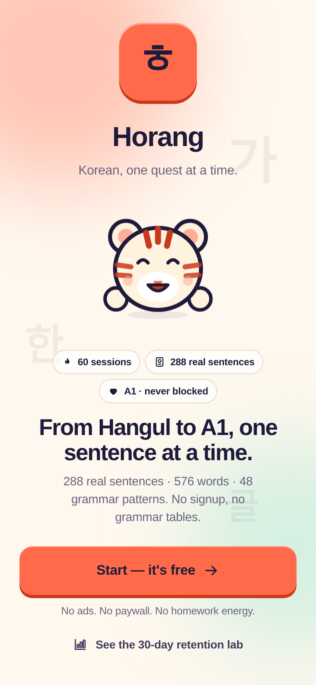
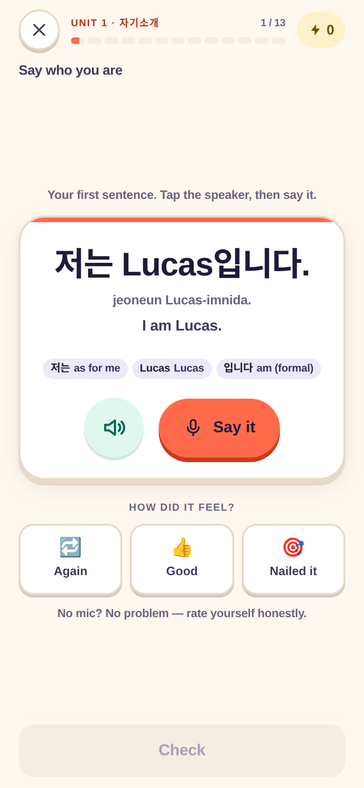
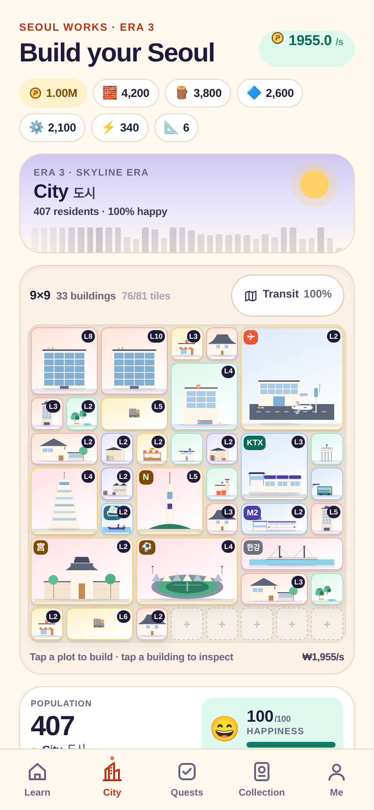
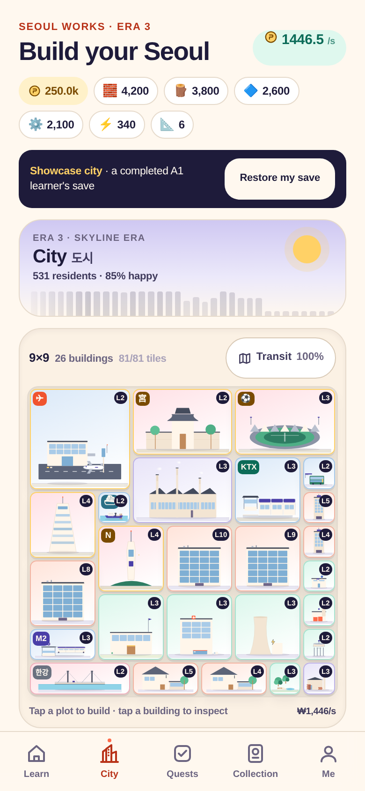
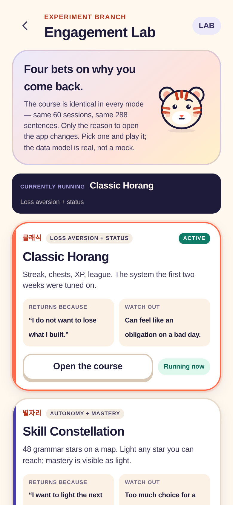

# Horang 호랑

**From Hangul to A1, one sentence at a time.** A complete CEFR A1 Korean course built as a game: 60 sessions, 288 sentences, 576 words, 48 grammar patterns, 13 task types, neural Korean audio, and a retention engine that uses real memory decay as the reason to come back.

| The hook | The lesson | The city |
|---|---|---|
|  |  |  |

---

## Run it

No build step, no framework, no runtime dependencies.

```bash
npm start          # → http://localhost:4173
```

Then open the **Retention Lab** (`Me → Retention Lab`, or `#/demo`) and press **Run the whole A1 course**. It time-travels the real app state through 60 days — including a 4-day lapse and a comeback — and ends with 288/288 sentences, 12/12 unit badges and the A1 exam.

### Reviewer tour (≈4 minutes)

| Time | Do this | What it proves |
|---|---|---|
| 0:00 | Welcome | Value before signup: 288 sentences, 60 sessions, A1 |
| 0:15 | Goal → time → name | Three taps configure the course and the daily XP goal |
| 0:30 | Start session 1 | Their own name becomes sentence #0 (`저는 Lucas입니다`) |
| 0:40 | Word cards → listen → build → write → say | 13 task types, neural audio, instant feedback |
| 3:00 | Session complete | XP, stars, "N new sentences met", words practised, chest |
| 4:00 | Home | Daily plan, A1 progress, 12-unit course map |
| 5:00 | `#/demo` → **Run the whole A1 course** | 60-day retention proof + A1 certificate |

---

## The course

| | |
|---|---|
| Level | CEFR **A1**, designed for learners who can already read Hangul |
| Units | 12: introductions · daily life · food · shopping · places · time · family · hobbies · past · plans · health · travel |
| Sessions | **60** (per unit: vocabulary, grammar, listening, reading, checkpoint) |
| Sentences | **288** with romanization, English, word-by-word gloss and 3 distractors |
| Vocabulary | **576 entries** (520 unique), each with POS, audio and an example |
| Grammar | **48 patterns**, each with a one-line explanation, 2 audio examples and a common mistake |
| Dialogues | **12** (6–10 lines, two neural voices) |
| Readings | **12** short passages with 3 comprehension questions each |
| Assessment | 12 unit checkpoints (80 % to pass) + a 30-question final A1 exam + printable certificate |

### 13 task types

`word_card` · `grammar_card` · `listen_pick` · `translate_pick` · `tile_build` · `fill_blank` · `type_answer` · `dictation` · `dialogue_reply` · `reading_q` · `word_pick` · `word_match` · `say_it`

Lessons differ by kind: vocabulary opens with word cards, grammar starts with a pattern card and drills it, listening is audio-first with dictation and dialogue, reading is passage-first, and checkpoints are 12 mixed items with no hints.

---

## Seoul Works — the city you build by studying

A Cities-Skylines-flavoured builder on the **City** tab. Study is the only source of materials:

| You do | You get |
|---|---|
| Finish a lesson | Bricks (+3 for a perfect run) |
| Review sentences | Timber |
| Practise words | Glass |
| Pass a checkpoint | Steel + a blueprint |
| Hit the daily goal | Energy |

A **31-building** catalogue spans homes, offices, industry, schools, hospitals, police/fire, power and water, buses, metro, rail, ferry and an **airport**, plus landmarks (Gyeongbokgung, World Cup Stadium, Lotte Tower, N Seoul Tower, Han River Bridge). You place them on a grid — including 3×3 airports — upgrade through 10 levels, and they generate **Won per second** — the same Won used in the shop. Factories produce materials per minute, parks boost neighbours, and transit (bus → metro → train → airport) raises coverage and happiness. The city earns while you are away (8 h cap), and **prestige** starts a new era with a permanent +50 % income.

See `docs/CITY-SPEC.md` for the full catalogue and formulas.

### See a finished city

Open **`#/city?showcase=1`** (or **City → Showcase**) to load a legitimate completed save: **26 buildings on 81/81 tiles**, 531 residents, 85 % happiness, 100 % transit, airport, KTX, metro, palace, stadium, Lotte Tower, N Seoul Tower and the Han River bridge. It assumes a completed A1 learner (12 badges). Your save is backed up; **Restore my save** puts it back.



## Engagement Lab (branch `gamification-lab`)

This branch adds three **alternative engagement systems** on top of the same course, switchable at `#/lab` (Me → Engagement Lab):



| Mode | The bet | What changes |
|---|---|---|
| **Skill Constellation** | Autonomy + visible mastery | 48 grammar stars on a map; light any star you can reach; tap → targeted 5-sentence practice |
| **Bounty Board** | Autonomy + challenge | Choose one of three daily bounties (safe / risky / epic); no stake, no penalty; claim on completion |
| **Co-op Expedition** | Relatedness + role | A shared weekly 2,400 XP goal with four **labelled** pace-setters; pick Scout / Scribe / Envoy for +10 % XP on matching tasks; unlock a Seoul diary chapter at each 25 % |

Full rationale, risks and the A/B plan: **`docs/ENGAGEMENT-ALTERNATIVES.md`**. Logic tests: `tests/engagement.test.mjs` (35 assertions). UI tests: `tests/lab.mjs`.

The classic stack on `main` is untouched; these are additive prototypes, not a redesign of the course.

---

## The Korean voice

The MVP used `speechSynthesis`, which falls back to whatever the OS has installed (often a robotic formant voice). The A1 build ships **pre-generated Microsoft neural Korean audio**:

- Default narration: `ko-KR-SunHiNeural` · second dialogue voice: `ko-KR-InJoonNeural`
- **96 kbps** MP3 (edge-tts defaults to 48), warmer prosody (rate −6 %, pitch −2 Hz), plus a slow version of every sentence
- **Three selectable voices** in Settings — SunHi, InJoon, Hyunsu — with an instant sample
- **~1,350 clips** committed to `app/audio/`, so the app works offline with no key
- **Dynamic neural TTS** for text that cannot be pre-generated (the learner's name in sentence #0): `GET /api/tts?text=…&voice=…`, cached in `app/audio/dyn/`
- No OS voice is used anywhere while the local TTS endpoint is available

Generated by `tools/generate-audio.mjs`; setup in `tools/README-audio.md` or `tools/setup-tts.sh`.
Why the encoder and fallback matter: **`docs/AUDIO-QUALITY.md`**.

---

## Engagement, beyond the MVP

- **Daily plan** — three concrete wins (1 lesson, 10 reviews, 6 words) with a 60-coin completion bonus.
- **Course map** — 12 units with a five-node rail; current unit open, completed units collapsed, locked units honest.
- **Collection** — 288 sentences and 576 words, searchable, filterable, paginated, with mastery pips.
- **Word SRS** — a separate trainer with due words, flashcards and a word bank that fills as you learn.
- **Grammar library** — all 48 patterns, searchable, with audio examples and a direct practice link.
- **Unit badges + A1 certificate** — 12 checkpoint badges and a printable final certificate.
- Retained from the MVP: streak + freezes, chests with published odds, crits and combos, daily quests, weekly league with labelled pacers, honest memory decay, and the comeback offer.

Design rules still enforced: no energy wall, no paid loot boxes, no fake users, no guilt copy, no confiscating earned progress. See `docs/CONCEPT.md`.

---

## Tests

```bash
npm test           # starts its own server, runs core + browser journey + 60-day lab
```

- `tests/core.test.mjs` — **70 assertions**: content shape, task generation for all 13 types, grading, SRS, unlock rules, checkpoints, word mastery, economy.
- `tests/e2e.mjs` — real Chromium: onboarding → four lesson kinds → checkpoint → home → collection → word trainer → grammar → exam gate → profile → reload → desktop 1440×900, with overflow checks.
- `tests/demo.mjs` — runs the 60-day A1 simulation and asserts the end state.
- `tests/city.test.mjs` + `tests/city-sim.test.mjs` — **438 assertions** on the city economy, multi-tile footprints, population/happiness/transit, tiers, achievements and prestige.
- `tests/metropolis.spec.mjs` — **459 browser/environment checks** on the metropolis build, migration, overlay, gating and integration.
- `tools/validate-content.mjs` — 0 errors across 12 units (schema, refs, Hangul, particles, duplicates, batchim).

Last full run: `docs/verification/test-run.txt`.

---

## Structure

```
index.html                  app shell (mobile-first, 3-column at ≥1160px)
server.js                   zero-dependency static server
app/data/a1.js              generated A1 course (489 KB)
docs/content/a1/u*.json     the 12 authored unit files
app/audio/                  ~1,050 bundled neural clips + manifest
app/js/core/course.js       lookups, unlock rules, unit progress
app/js/core/engine.js       60 sessions, lesson composition per kind
app/js/core/quiz.js         13 task generators + grading
app/js/core/store.js        economy, SRS, checkpoints, words, daily plan
app/js/core/audio.js        bundled clip playback with speech fallback
app/js/screens/*.js         welcome · onboarding · home · lesson · complete ·
                            quests · shop · league · collection · profile ·
                            settings · vocab · grammar · exam · demo
tools/                      content validator, builder, neural audio generator
docs/A1-CONTENT-SPEC.md     the content contract (units, grammar map, schema)
docs/A1-BUILD-SPEC.md       the screen/task contract
docs/CONCEPT.md             the retention thesis
docs/research/              three research specs (mechanics, curriculum, UX)
```

---

## Scope

The course now covers **A1 end-to-end**. A2 content (past/future narration, connectors, honorifics in depth, longer texts) is **not** started — that waits for the next go-ahead.

Audio licensing note: the clips are generated with Microsoft's Edge neural voices via `edge-tts` for this prototype. Before a commercial launch, move to a licensed TTS contract or record human voice actors with the same script and ids.
