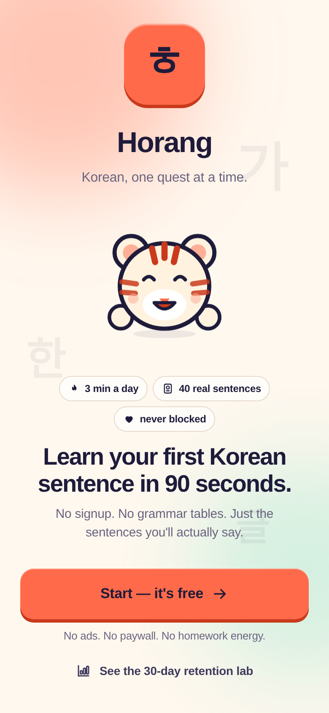
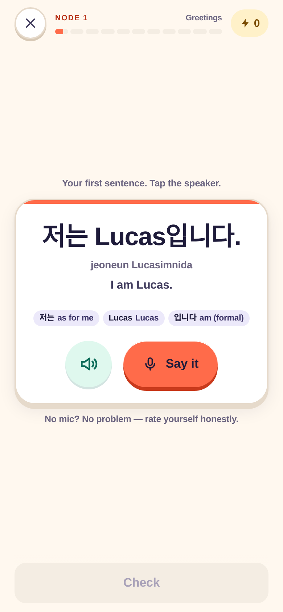

# Horang 호랑

**Korean, one quest at a time.** An MVP for an addictive Korean study app: 40 real beginner sentences, 3-minute nodes, crits, chests, streaks, a league, a 40-stamp Passport — and a spaced-repetition engine whose decay is the honest reason to come back tomorrow.

| The hook | The lesson | The proof |
|---|---|---|
|  |  |  |

---

## Run it

No build step, no framework, no runtime dependencies.

```bash
npm start          # → http://localhost:4173
```

Then open the **Retention Lab** from the welcome screen (or `Me → Retention Lab`, or `#/demo`) and press **Run full 30 days**. That is the fastest way to see the whole concept: it time-travels the *real* app state through Day 0 → 30, including a 4-day lapse and a comeback.

### Reviewer tour (≈3 minutes)

| Time | Do this | What it proves |
|---|---|---|
| 0:00 | Land on the welcome screen | Value before signup: one headline, one button, no account |
| 0:15 | Goal → time → name | 3 taps configure the whole experience |
| 0:30 | **Start node 1** | The user's own name becomes sentence #0 (`저는 Lucas입니다`) — a real, stamped sentence |
| 0:40 | Answer 11 exercises | Listen → pick → build → speak, instant feedback, combo, crit, XP, level-up |
| 3:00 | **Node complete** | Stars, XP count-up, 3 new stamps, chest unlocked, quiet Day-1 streak |
| 3:30 | Quick check (skippable) | Placement, not gatekeeping |
| 4:00 | Home | Three unfinished bars, the path, Sentence of the Day, quests, next step |
| 5:00 | `#/demo` → **Run full 30 days** | Retention proof: streak, league, decay, lapse, comeback, 40/40 Passport |

---

## What is implemented

| Mechanic | Where to see it | Why it works |
|---|---|---|
| Personalised sentence #0 (no signup) | Onboarding → name | Self-reference effect + endowed progress that is auditable |
| 6 exercise types, 3 touches per sentence | Lesson | Encoding variety; production, not recognition alone |
| Crits: 15/20/25 %, guaranteed 10th answer | Lesson, `+20 XP CRIT ×2` | Variable-ratio reinforcement |
| Combo counter | Lesson (from ×3) | Immediate feedback + loss aversion on the streak of answers |
| Chests: 3/day, 70/25/4.7/0.3 %, pity timers | Complete → Shop | Anticipatory reward; odds are published, chests are never sold for money |
| Streak + 2 freezes, gifted Day 2/7 | Home, Profile | Loss aversion on an earned asset — with insurance, no guilt copy |
| Daily goal 60/120/180 XP | Home | Goal gradient + a daily appointment |
| Daily quests (11-template pool) | Quests | Zeigarnik effect + cumulative progress |
| 40-stamp Passport | Passport | Sunk-cost/IKEA effect, but the asset *is* the learning record |
| Week league, 30-person cohort, labelled Pacers | League (Day 7) | Social proof; pacers are explicitly labelled, never fake humans |
| Vocabulary taught inline | Lesson *say it* gloss, complete-screen word bank, Passport Words (75 words) | Words are met in a sentence first, then drilled as a collection |
| Grammar taught in contrast | `fill_blank` (은/는, 이/가, 을/를, -아요/-어요), grammar tags, pack Guidebook | One contrast at a time, always inside a real sentence |
| SM-2-lite SRS + decay | Home fading alert, Profile memory health | The return trigger is real memory decay, not a guilt notification |
| Lapse + comeback (Rekindle) | Home banner, Retention Lab | Restores half the streak; never confiscates XP, stamps or coins |
| Retention Lab | `#/demo` | Proves the retention calendar on the real code paths |

**Not in this MVP** (deliberately): accounts/backend, real-money store, ASR pronunciation scoring, boss-roleplay screens, friends/duels, notifications via a server (the reminder time is stored; the delivery layer is stubbed).

**Scope guardrail:** the MVP teaches absolute-beginner sentences only. Per the brief, proficiency is **not** being expanded to B2 until the concept is signed off.

---

## Tests

```bash
npm test           # starts a server, runs core + browser journey + retention lab
```

- `tests/core.test.mjs` — **48 assertions** on the economy, SRS, unlock logic, decay, chests, quests, league, shop.
- `tests/e2e.mjs` — **35 browser checks** in real Chromium: onboarding → 11-exercise node → complete → placement → home → quests → shop/chest → passport → profile → settings → league → retention lab → reload persistence → desktop 1440×900, including horizontal-overflow checks at 390 px. Fails on any console error.
- `tests/demo.mjs` — runs the 30-day simulation and asserts the end state.

Last full run: `docs/verification/test-run.txt` — **84 assertions passed, 0 failed, 0 console errors.**
44 screenshots live in `docs/screenshots/`.

### One observed 30-day run

```
day 30 · 7,110 XP · level 14 · 40/40 stamps
streak 9 (best 17) · 5,438 coins · 14 chests opened
league joined on Day 7 · 4-day lapse at Day 19 · streak repaired on return
```

---

## Structure

```
index.html                 app shell (mobile-first, 3-column at ≥1160px)
server.js                  zero-dependency static server
app/data/curriculum.js     40 sentences · 7 packs · 75 words · grammar spine
app/js/core/store.js       state, economy, streak, quests, chests, league
app/js/core/engine.js      14 nodes, session builder, 3-touch rule
app/js/core/quiz.js        the six exercise generators + grading
app/js/core/srs.js         tiers, intervals, decay
app/js/core/clock.js       virtual clock (what the Retention Lab moves)
app/js/core/ui.js          icons, mascot, overlays, confetti, rings
app/js/screens/*.js        welcome · onboarding · home · lesson · complete ·
                           quests · shop · league · passport · profile ·
                           settings · demo
docs/BUILD-SPEC.md         the contract the screens were built against
docs/CONCEPT.md            the retention thesis, in detail
docs/research/             three research specs (mechanics, curriculum, UX)
```

---

## Design rules that were enforced

1. **Learning is never blocked.** No energy wall, no hearts on normal nodes. Focus is quarantined to bonus modes and is not implemented as a gate.
2. **Every number is real.** No fake users, no fake scarcity, no fake counters. Pacers are labelled. Chest odds are published.
3. **Loss frames describe real memory decay**, and decay never drops more than one tier per lapse.
4. **No guilt copy.** No “we miss you”, no sad mascot, no day-count shaming.
5. **Every session ends with a named next step** and exactly three unfinished artefacts on the hub.

---

Made as a proof of concept. Korean content is polite-form, modern, and proofread against the curriculum spec; audio uses the browser's `ko-KR` voice.
